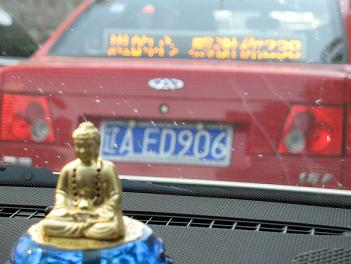
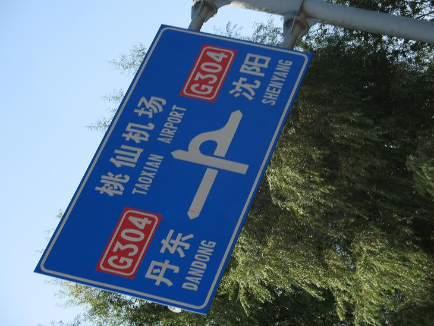
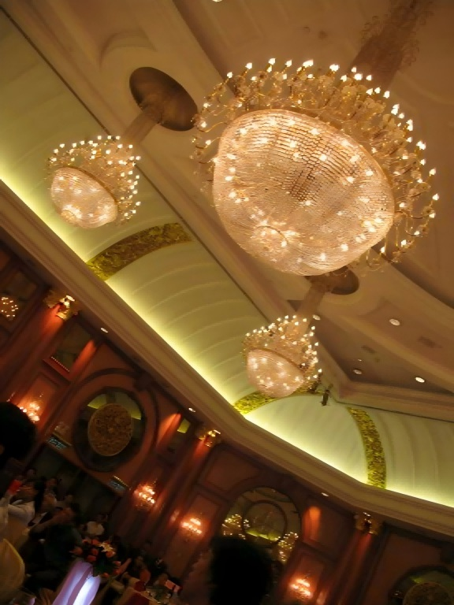
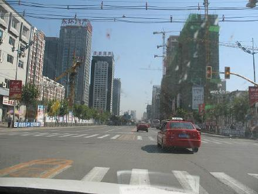

 愿天庇佑沈阳……

 下一站“何处”

妹妹的婚礼，祝她永远幸福……

 永远在路上……

外婆的离去几乎带走了我对沈阳的最后一丝留恋。

如同弃婴般对母体没有任何的感动，很奇怪我对生我养我的这座城市，总感觉语焉不详。

没有感觉，无关好坏。甚至下午在去机场的路上透过取景框中擦身景物的渐行渐远竟会感受种意外的恍惚：是否我真的在此生活了16年？

那些记忆，及记忆中的那些人都成了碎片飘散在风中。脱离了我的意志完全成了个体，飘荡在这城市的上空踪影难寻……

沈阳。我的城市。我的童年。我的梦。

印象中的沈阳，工厂林立，空中总是浮着薄雾般的灰质。全国的重工业中心，那时的沈阳人为此付出了全部的自己。

总有副画面出现眼前：那是冬天，天总是黑得早。妈妈下班的时候，天已漆黑。污雪制造的泥泞，深刺骨髓的寒冷……妈妈骑着她的单车穿梭于这个阴冷的城市，从工厂到家，日复一日……那时的她，总是我的温暖，我的港湾，我的坚强……

今天，妈妈苍老了。变得不再那么坚强，变得需要我去照顾……人总会老去，可脑海中那个画面永远清晰，因为那时的我总在企盼，盼望着那个风雪中的人快点回来，为我做饭。每次不管她的辛劳，总是第一时间的抢过她手里的包去翻里面是否存在惊喜……那个女人，我的妈妈，她已经和从前的沈阳紧紧地联系在一处，无从剥离。

如今，这城市变得面目全非。几乎再也找不到从前的影子。我在怀疑，是否我的那些故事真的曾上演在这里？那些人是否真的出现过？

总是觉得。

沈阳。不该是这个样子。该是我梦里的样子。

梦里的样子……
