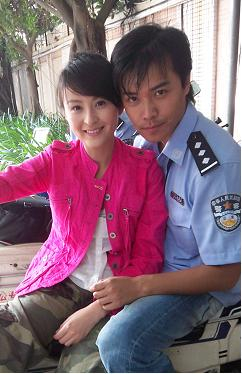
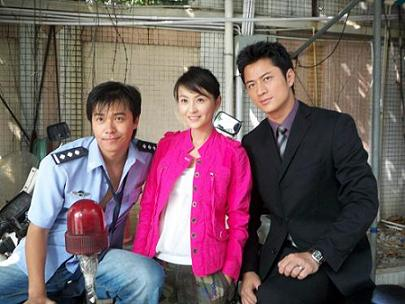

&nbsp;&nbsp;听过这首歌吗？“我们都是好孩子”？喜欢……

昨天，公主同学走了。她是个好孩子。是造物主留给这个世界的惊喜。林江国同学会陪我到最后，还好。

有的时候是这样，不知不觉，我们成了我们。 机缘巧合环境影响……一切措辞不过是命运留给这世界的一个托辞，其实我们都被安排了，早就注定了，善的恶的美的丑的功的罪的缘的孽的还的报的我们的你们的他们的……

我抹去一方灰尘，看到了里面，本质，那是一种光亮，未被侵染过多，未曾同化过久，我仿佛穿越了时空，看到了以往的自己……不！那明明就是自己。自己也曾有过的无邪的笑，孩子一样……白衣飘，高声歌，追逐着，跳跃着，手拉手，奔向，咖啡色的夕阳，那天边外……

身边的日子只是在静静溜走，没心没肺，从不停留，永不回头。我们随波逐流竭尽所有也只能随波逐流，远去，远去，再远去……直至被淹没……但不会没有一点痕迹吧，不会吧……

因为我们都是好孩子，我们都会感恩，都会流泪，都会用力去拥抱爱……我们都是宠儿，是不会被离弃的，坚强背后的柔是我们的共性，是泪眼后的笑，是我们的真……真的就不会不见……

又一段岁月即将结束，人们陆续离开，记载这一切的不该只是那些正版或盗版的音响制品吧，还会在我们的心里，至少。祝大家都好吧……

再次相见，何年何月何时何地？

我想你会笑着答。

你猜……
