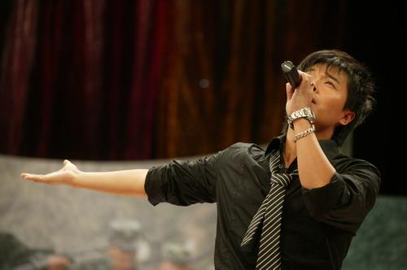
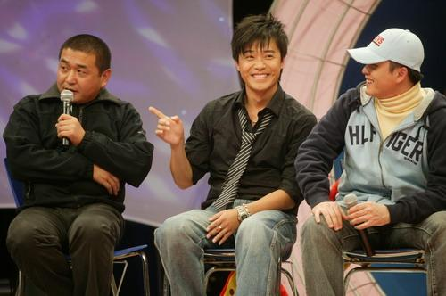
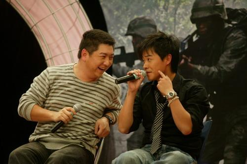
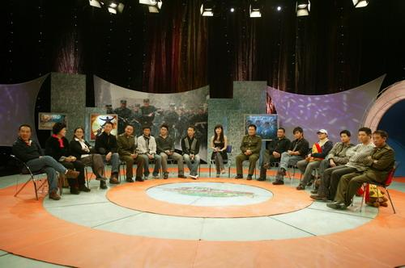

在烟花浪漫的夜晚...我对你倍加的思念......

这个银...就是传说中的幕后黑手...4哥...

“星梦奇缘”——喜欢这个名字。因为，浪漫。

缘，妙不可言。世间万事万物皆能用一“缘”字解释个通透。你们与那些角色是缘，我与那些角色也是缘，我与你们更是缘……

终于爱上了演员这个职业。在今年。希望还不晚，应该还不晚。

从前的我抵触，觉得“被选择”不男人，“主动”才王者。所以我徘徊，忧郁，浮沉……

年初的一部戏，让我真正沦陷。那故事那爱情炙热得眩目，又残酷得血肉模糊。但那完整那纯粹那干净和我的理想勾芡的严丝合缝几乎没半点瑕疵。于是，我爱上了那故事，爱上了那剧中人……“成才”让我成长，这角色却更让我成熟。

经历后，我才算明白了点这个职业，明白了这个职业需要的坚信，艰辛，坚持，坚守……

我们是用自己塑造，全部的自己。这全部包括肉身，心灵和情感，你所有的全部，全部的全部。所以我们很难有自己，所以我们很容易被裹挟，所以我们才脆弱，易碎，矛盾，游移，情绪，任性，敏感，多疑，自律且自渎，自曝且自闭……我们唯一的工作是进步，唯一的进步是丰富，唯一的丰富是自己，唯一的自己是使命……

不断的自我认知，自我完善才是这个职业也或是这个人生的合理解读吧……明白后，便不再困惑，便更清了方向，更充沛了步伐……

接下来就遇到了你们，梦中的那部分……幸福来的促不及防，甚至如暴发户般的奢侈。放心，我们会珍惜，不会挥“金”如土！因为我们是“步兵”！是一步一步走出来的兵！就如帖吧里的一位朋友说：“五班——曾经成才口中那班长的坟墓

孬兵的天堂，却真正的才是成才的福地……”愿所有“士兵”的战友们，都早日找到各自的“五班”。因为7连好，老A易，5班才是我们对自我认知和成长的绝地……

“星梦奇缘”30年，祝愿大家从这一刻开始，真正迎来属于自己的30年……

两个说相声的……望30年后，依旧能如此“四目相对”“笑靥入花”……

“星梦”全家福……
