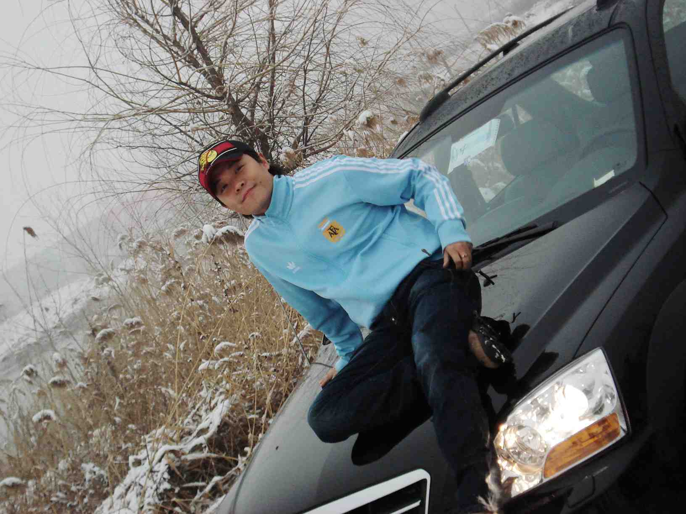
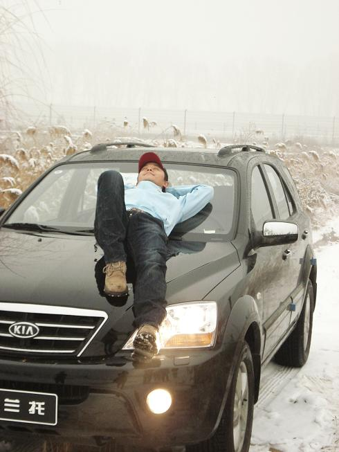
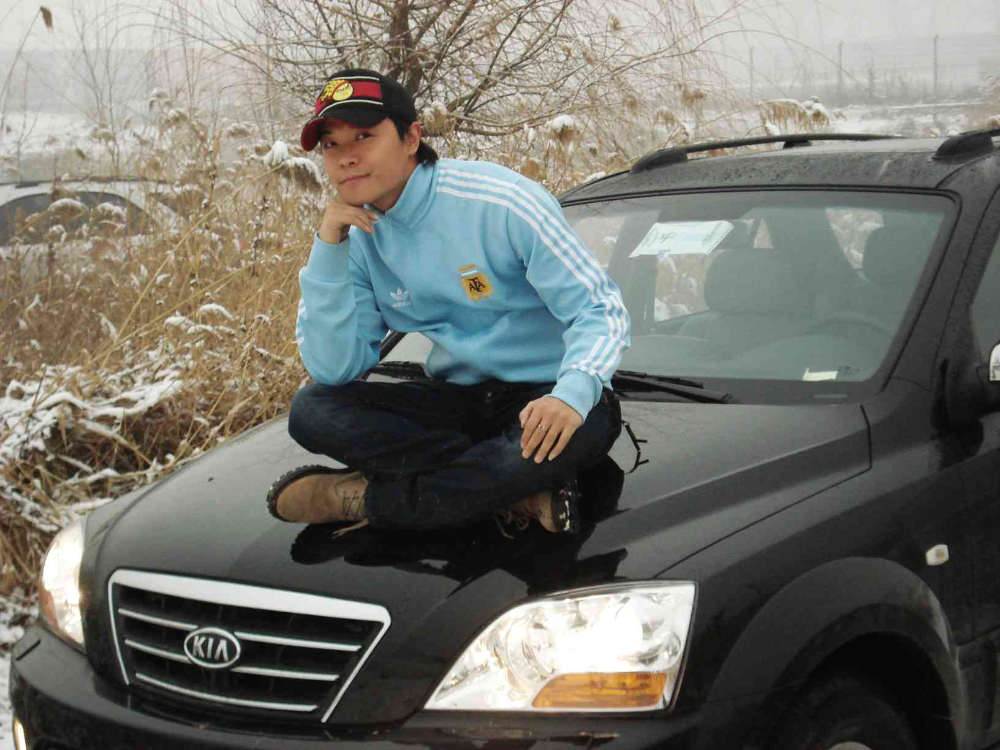
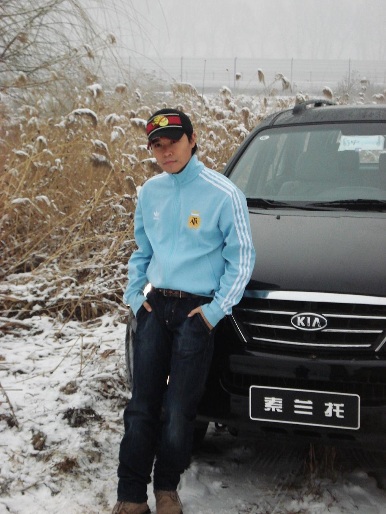
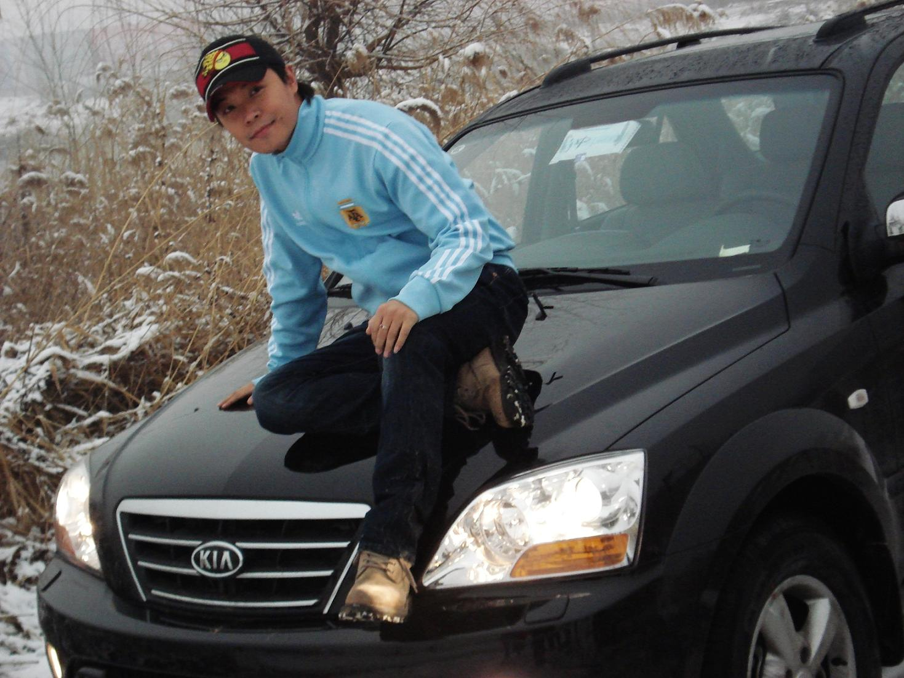

明天一早六点就要起来.去济南.算了算,又没几个小时好睡...

本不该来,不该写.但为了今冬的初雪,纪念,值得.

下午寒风很特别,因为有雪,还因为参加了个新车试驾 --
泥泞,崎岖,颠簸...无谓!

教练说的很好"越野"---英文"OFFLAND"本来就该在没有路的路上踩出路!一个车的态度!如同人生!

更坚定了我换车的想法!LAND  OFF

前两天,一个人,深夜,驱车,回家...孤独,无以名状.想到了即将到来的节日...孤独陷得更深!如果没有点雪,那么这个圣诞会更加的失色了吧......

还好,她来了.突然得促不及防.早晨醒来,隔窗忘去,已是满眼的雪银了...

北方就该这样,没有这点雪,此刻的北方还算是北方吗?

北国风光,千里冰封,万里雪飘...毛爷爷爱雪如同爱女人爱江山...

又一次馈赠!

她像个礼物,从天而降,落在身上,却温暖了别处...

看到雪,你会觉得自己是个诗人...

用手盛住,或直用身体迎接!她们无论在你的哪儿,都会悄悄消融,是你体温的一部分,是你脸夹的那片红.

你会觉得感动.

会觉得---

活着,真好...
