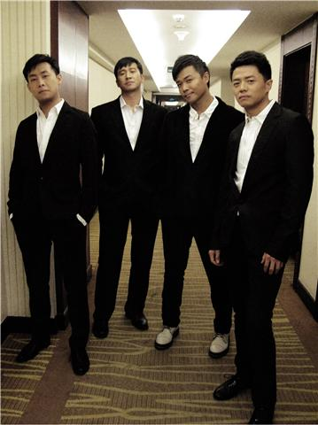

海。

……人海中相逢相知相守不觉已数载。诸君变化心知自知。感动缘自赤诚，风吹雨打百炼成钢的赤子之心。每每脸上漾起孩童般的笑便是毫无掩饰的一个真男人。

男人，便是难人。能携手走过一段路，无论叱诧平凡或陨落都不觉唏嘘。千金散尽，黄梁梦醒，又是一片新沧海。举杯共醉，对坐有你，才乃真的慨而慷！

今朝有酒，便指点江山嬉笑怒骂哪管他人怎个评说，徒自昏噩冷眼世间万种清醒……

明日上路，看谁可奈何乘风破浪凡尘叹我如此参破，纵横四海举手投足皆成文章……
