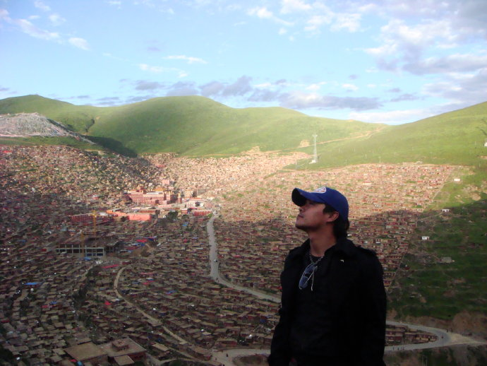

中国传统的阴历年计，今天，才是这年的最后一天。

明天，一切又是个开始。新的一年，新的启程……

09年不想说太多，相对回首此时我更愿展望。

‘仰视天堂’是03年我为班里写的一个毕业大戏，后因校方干预无疾而终……

艺术创作上不存在孤注一掷，任何心血都不会付之东流。如同我的‘奇迹’，那些影响都深植于我的骨格血脉与我融会贯通于一处，所以我不绝望，艺术，不存在流产。

请允许我说‘艺术’，相对于现在的浮躁。

再一次的仰视天堂是于09年中，我身后的苍穹青山云朵霞光都仿佛是那上万间僧舍的映衬——甘孜州阿坝州的藏区，团坐着全世界最大的佛学院——五明。

在那里你的心会澄清的透明，想大喊，想默念，想倾吐，想忏悔……心向往之，甚至愿化青烟一缕浅挂天边片刻俯瞰——芸芸众生，其实和那白云苍狗没有两样，聚散终如一曲毕，并无绕梁三日音……

我信佛，也信有天堂，更信我们那7克重量不会无的放矢，尘归尘土归土，一切机缘终究都会有个去处。

且让我们静坐菩提岸，笑看时光转，一杯酒一盏茶，一个吻一滴泪，一首歌一场梦，一世痴迷一生荒唐的走过吧……

不愿你别的，只想你善良……

新的一年就要来了，祈福所有此篇观者，下一年中幸福安康……阿弥陀佛虎年吉祥……
