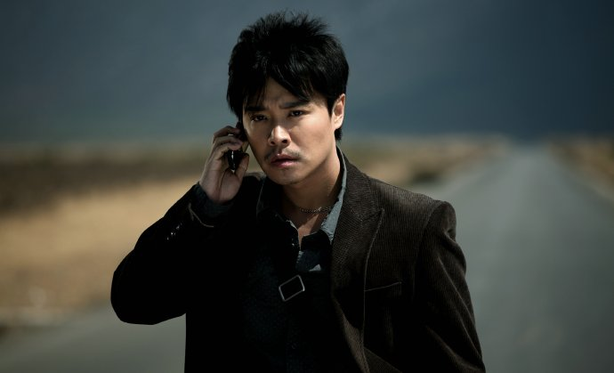
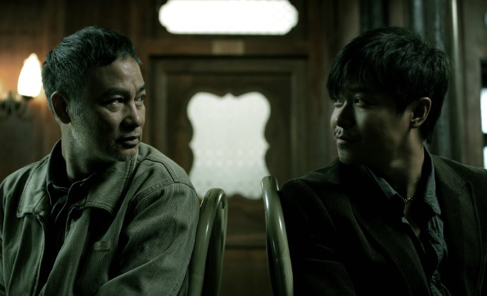

“天边外祭奠”是我大学时期自编自导自演的一部话剧。改编自奥尼尔的第一部戏剧作品“天边外”。今晚忽然想起这个名字，只为一个人，哥哥……
拍摄“守望者”的时候，某台每晚深夜总会播哥哥曾经的作品，从“英雄本色”“倩女幽魂”到“霸王别姬”……宛如哥哥的一部成长史，我看到一个青涩少年到倾国倾城的转变……又是4月1日，又是一个愚人节，但愿此后不要再有这样的“玩笑”与我们，与我们这些活着的可怜的人们……我知道，此刻你正在天边外的某处，笑得依旧那么温暖灿烂，可你会否想到，俗世中的我们正在把你想念把你祭奠……哥哥，愿你永生……你已永生……

背后的公路延伸于无限，我们的双眼同样未知……困惑的一定不只是我，是所有的世人……

这张照片让我有浮生若梦的感觉和感动，华哥，另一个香港的传奇，那天，我们同样怀念起了哥哥……

这是个创造传奇的时代，真正的传奇就在我们身边……

我知道，此刻，你就在天边外，你在听，你在看……

