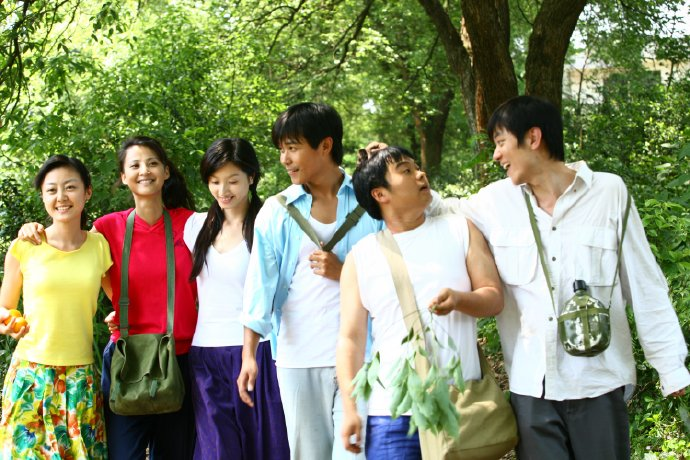
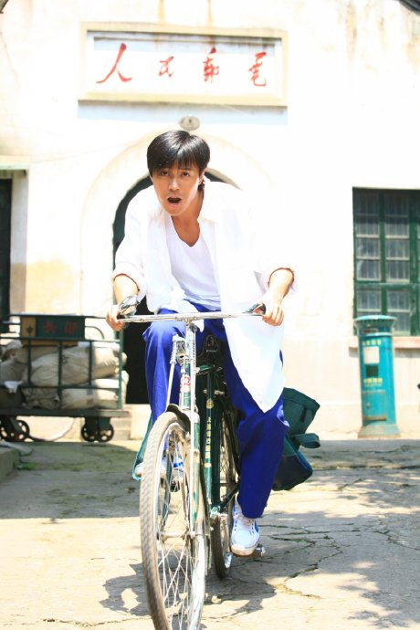
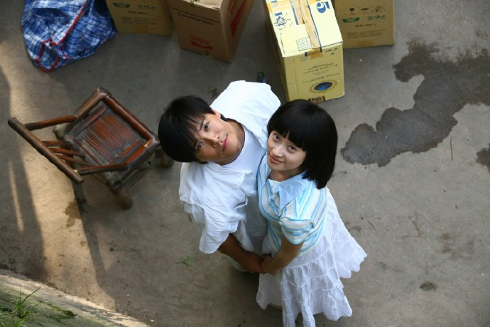
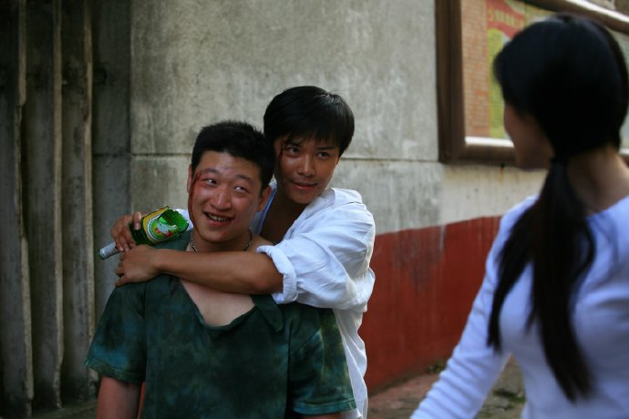
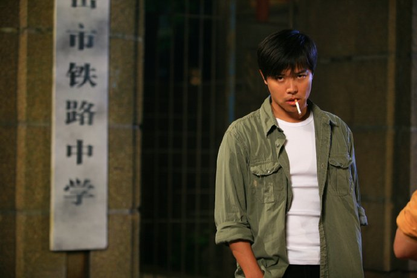
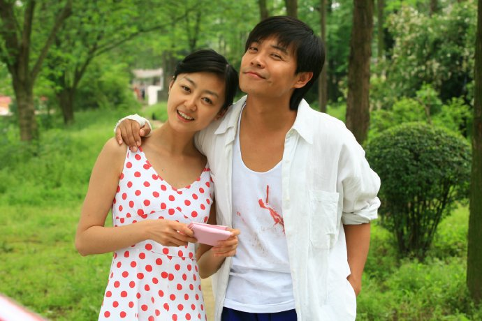
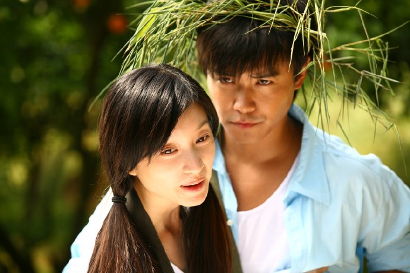

《爱是一颗幸福的子弹》快播完了，看着曾经的作品，心情抑制不住的激荡...

好吧，此刻就让我们试着一起回忆……

耳边，回荡着的“子弹”的插曲，再一次把我带回了那个夏天。

湘江边的空气中总有一种青草的味道，风懒洋洋的盖在身上，我们坐在岸边，没有话语，一切如你眼波般安详……夕阳，如一副油墨画，把我们和对岸染成了金黄……光芒中，你们几个的脸上都挂着浅浅的笑，同样出神的遥望远方，不知在醉着什么……那美好忽让我感伤，要能永远这样多好，青春便可不老……我想。远处的汽笛声踟蹰而至，伴随我目光悠然前行的旧船便把一切带进了故事……

那是80年代，远比我们此刻的世界浓郁简单澄净……那是可以手牵手在岸边相对无语从清晨到日落的岁月，那是诗歌伴随着口琴声和白衬衫在风中飘扬的日子，那是炙热的情欲裹杂在羞涩的表达懵懂的情感与满心的期盼和憧憬的年代，那时的我们，无论欣喜或感伤都是如此无尘……

眼泪，是成长的代价。如哪天，你的泪不再流了，想说，那不是你大了，而是，你的心已经死了。

“子弹”这个戏也许真的是名字不好吧，才会如此多舛。三年后，才在这样的一个时段播出。但我想，“子弹”的纯净和不同是有违绝大部分影视剧的，她会让所有“有心人”都过目难忘……尤其是我们，被“子弹”穿越的我们，每一个人对这部作品的情感都是深刻而异样的。

爱，是一颗幸福的子弹！被它击中，幸或不幸答案会有不同。所幸，有这样的一个夜晚，这样的一个契机，我可以时隔三年后，重温那如梦的五月，并再一次问问自己……我是否仍有身躯去迎接那幸福的死亡？……

