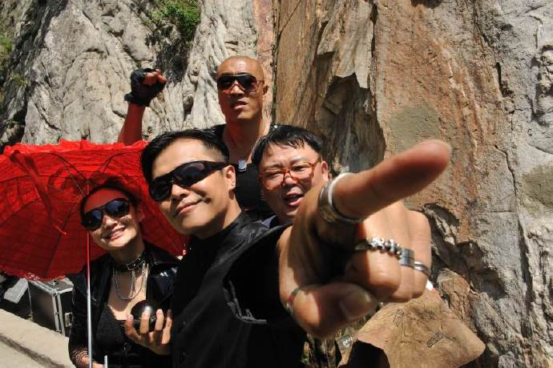
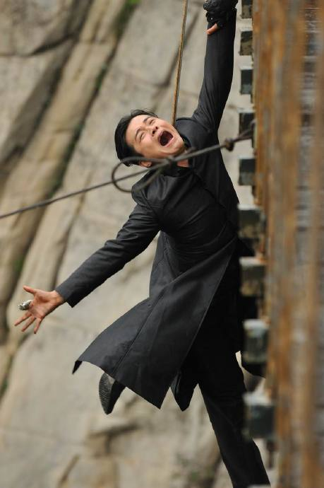

小罗汉23日上映来，各地反响不一，可见广告的力量之强大！！上海的上座率超高孩子们超爱，除片子本身质量外很大部分源于SMG的上海广告推广！剩下的城市“小罗汉”几乎被“大地震”吞噬了……

没错，小罗汉之“小”与大地震之“大”简直微不足道，但我相信我们所有主创对电影的热忱之心一点也不少！

小罗汉绝对是一部有诚意的电影！尽管除了褒奖外也不乏批评之音，但我在想，我们是不是真的该放下“高傲”的心，来平视一部这样的儿童影片呢？

中国电影（内地）刚刚起步，市场化刚刚开始，类型片刚刚露头，我们现在是否就要拿所有的片子去和好莱坞成熟多年的市场去比较？我们能否对中国的电影和电影人宽容一些呢？

另，大地震的霸主味道无可厚非，但我们的“院线经理们”是否也该给些小片的空间？否则，长此以往，不怕无“小”就无“大”了吗？如果真有那么一天，才是华语电影的悲哀！

为我所喜爱和投入了诸多热情的“小罗汉”加油！并再一次推销！这不是一部没有缺点的电影，但绝对是一部可以让你欢笑的电影！我们就用孩子般的心态去体会孩子般的经历在银幕前坐一个多小时的孩子吧，如果是这样你一定会和你周围的孩子们笑在一起，并深深地爱上这部电影……

最后，呼吁社会——这是毕竟是暑期啊大哥，真正放假的是孩子们！咱们是不是真的应该想想多留些他们能看爱看的东西呢？？？除了让孩子们哭，也总得让孩子们笑吧……

最后的最后，还是那句，观后您真的觉得无趣——找我来报销票价好了！
